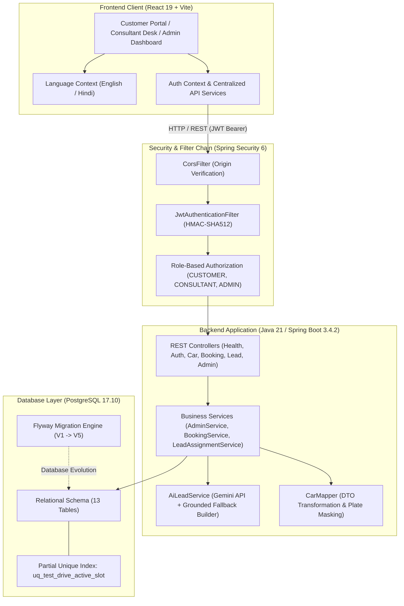

# AutoVista — Premium Dealership Management & Automotive Marketplace

> A full-stack automotive dealership management system and customer marketplace built for the **Isocode Labs Software Engineering Internship** take-home assignment.

AutoVista modernizes the automotive buying journey for enterprise dealerships in India (centered around Lucknow, Uttar Pradesh). It provides a unified platform connecting retail car buyers, sales consultants, and dealership leadership with database-backed on-road pricing, concurrency-safe test-drive scheduling, grounded AI sales assistance, and comprehensive audit trails.

---

## Table of Contents

- [Project Overview](#project-overview)
- [Problem Statement](#problem-statement)
- [System Architecture](#system-architecture)
- [Technology Stack](#technology-stack)
- [Features by Role](#features-by-role)
  - [1. Customer Portal](#1-customer-portal)
  - [2. Sales Consultant Desk](#2-sales-consultant-desk)
  - [3. Dealership Admin Dashboard](#3-dealership-admin-dashboard)
- [Key Engineering Decisions](#key-engineering-decisions)
  - [1. Partial Unique Index for Test-Drive Concurrency](#1-partial-unique-index-for-test-drive-concurrency)
  - [2. Booking Lifecycle & Privacy-Preserving History](#2-booking-lifecycle--privacy-preserving-history)
  - [3. Grounded AI & Human-in-the-Loop Governance](#3-grounded-ai--human-in-the-loop-governance)
  - [4. Automated Lead Distribution & SLA Tracking](#4-automated-lead-distribution--sla-tracking)
  - [5. Vehicle Registration Number Privacy Masking](#5-vehicle-registration-number-privacy-masking)
  - [6. Consent & Opt-Out Handling](#6-consent--opt-out-handling)
  - [7. Bilingual Customer Experience](#7-bilingual-customer-experience)
- [Database Schema & Migrations](#database-schema--migrations)
- [API Documentation Reference](#api-documentation-reference)
- [Getting Started](#getting-started)
  - [Prerequisites](#prerequisites)
  - [Environment Configuration](#environment-configuration)
  - [Database Setup](#database-setup)
  - [Running the Backend](#running-the-backend)
  - [Running the Frontend](#running-the-frontend)
  - [Demo Accounts](#demo-accounts)
- [Testing & Quality Verification](#testing--quality-verification)
- [Limitations & Future Enhancements](#limitations--future-enhancements)
- [Repository Structure](#repository-structure)

---

## Project Overview

AutoVista replaces fragmented automotive dealership operations with a cohesive, secure, and modern digital platform. The project addresses key friction points across the car-buying lifecycle:
- **Price Transparency**: City-specific on-road price breakdowns including state road tax (RTO), comprehensive insurance, standard accessories, handling charges, and TCS (Tax Collected at Source).
- **Certified Pre-Owned Inventory**: Multi-point diagnostic inspection verification, ownership history, and privacy-masked vehicle registrations.
- **Race-Condition-Free Booking**: Database-level concurrency control preventing double-booked test-drive slots while preserving complete customer booking and notification histories.
- **Grounded AI Sales Automation**: Factual buyer dossier generation and draft first-replies powered by LLM orchestration, with mandatory human-in-the-loop consultant approval before dispatch.

---

## Problem Statement

Traditional car dealership websites and internal tools often suffer from critical architectural and operational shortcomings:
1. **Opaque Pricing**: Customers are shown base ex-showroom figures, leading to sticker shock when state taxes, insurance, and statutory TCS are added late in the sales funnel.
2. **Scheduling Collisions**: Flawed slot booking systems either fail under concurrent user requests or reuse database records upon cancellation, corrupting customer audit histories.
3. **Slow Lead Response Times**: Incoming customer enquiries sit in unmonitored inboxes, missing the critical 5-minute sales conversion window.
4. **Ungrounded AI Dispatches**: Automated chatbots risk inventing unauthorized discounts, inaccurate delivery dates, or unrealistic vehicle specifications.
5. **Data Privacy Deficits**: Raw registration numbers exposed on used-car portals invite identity scraping, and customer contact preferences lack clear consent tracking.

AutoVista solves each of these challenges with strict database constraints, role-based security, disciplined domain modeling, and human-in-the-loop AI governance.

---

## System Architecture

The platform follows a layered, decoupled client-server architecture:



---

## Technology Stack

### Frontend
- **Framework**: React 19 (SPA)
- **Tooling & Bundler**: Vite 6
- **Routing**: React Router DOM 6
- **State & Communication**: Axios, Context API, Custom Hooks
- **Icons**: Lucide React
- **Styling**: Tailwind CSS & scoped CSS design system
- **Internationalization**: Custom bidirectional translation system (English and Hindi)

### Backend
- **Language**: Java 21 (LTS)
- **Framework**: Spring Boot 3.4.2
- **Security**: Spring Security 6 with stateless JWT (`jjwt-api` 0.12.6) and BCrypt hashing
- **Persistence**: Spring Data JPA / Hibernate ORM 6.6
- **Database Migrations**: Flyway 10
- **Validation**: Jakarta Bean Validation (`hibernate-validator`)
- **Boilerplate Reduction**: Project Lombok

### Database & Infrastructure
- **Database Engine**: PostgreSQL 17 (Production & Local Development)
- **Test Database**: In-memory H2 (for isolated, rollback-safe automated test suites)
- **LLM Integration**: Google Gemini API via secure backend proxy, paired with a deterministic factual template engine

---

## Features by Role

### 1. Customer Portal
- **Vehicle Catalog Exploration**: Browse new car models across trim variants, body types, powertrains (Petrol, Diesel, Hybrid, EV), and transmission options (Manual, Automatic).
- **On-Road Price Breakdown**: Real-time city-level pricing calculation displaying Ex-showroom Price, Road Tax (RTO), Comprehensive Insurance, Standard Accessories, Handling Fees, and TCS:
  - **TCS Calculation**: Implemented under Section 206C(1F) of the Indian Income Tax Act as 1% on vehicles with ex-showroom price exceeding ₹10,00,000 (and ₹0.00 for vehicles ≤ ₹10,00,000).
- **Certified Pre-Owned Marketplace**: Search used vehicles with verified mileage, ownership history, 150-point diagnostic inspection verification (`inspection_points_passed`), and privacy-masked registration numbers.
- **Test-Drive Booking Engine**: Select showroom or doorstep trial mode, choose an available date and time slot with live availability validation.
- **Booking Self-Service**: View personal appointment history, unique alphanumeric booking references (`AV-BK-YYYY-XXXX`), and cancel appointments with immediate slot release.
- **Customer Enquiry Submission**: Submit enquiries with optional budget, powertrain, and purchase horizon details.
- **Consent & Opt-Out**: Mandatory consent checkbox before submission, with one-click communication opt-out.
- **Bilingual Interface**: Header toggle between English and Hindi (`हिन्दी`).

### 2. Sales Consultant Desk
- **Dedicated Consultant Workspace**: Accessible only to authenticated consultants (`ROLE_CONSULTANT`).
- **Live Lead Queue & SLA Tracking**: Real-time lead dossiers displaying customer requirements, vehicle interest, and countdown to 5-minute initial response SLA.
- **AI Buyer Dossier**: Assistant-generated summary summarizing vehicle target, stated budget, preferred fuel/transmission, purchase timeline, and highlighted missing facts.
- **Draft Reply Generation**: AI-drafted first replies referencing specific customer enquiries without inventing unapproved terms.
- **Human-in-the-Loop Approval**: Mandatory consultant review and inline editing before simulated dispatch. Direct unapproved dispatches are blocked at the backend.
- **Simulated Communication Dispatch**: Mock dispatch over WhatsApp, SMS, and Email with audit logging (`lead_communications` table).
- **Lifecycle Status Updates**: Structured transitions (`NEW` &rarr; `CONTACTED` &rarr; `CONVERTED` or `LOST`) with required consultant notes.

### 3. Dealership Admin Dashboard
- **Executive Dealership Overview**: Real-time metrics for total inventory, new models, pre-owned cars, active bookings, total leads, and status breakdowns.
- **Consultant Workload Monitoring**: Real-time visibility into active leads assigned per consultant and team SLA performance.
- **Administrative Lead Reassignment**: Reassign leads between consultants with mandatory administrative reason logging.
- **Inventory & Pricing Management**: Manage car models, trim specifications, used car listings, and city tax rates.
- **Auditing**: Complete visibility into appointment logs, lead status mutation histories, and multi-channel communication logs.

---

## Key Engineering Decisions

### 1. Partial Unique Index for Test-Drive Concurrency

**Problem**: Traditional unique constraints on `(showroom_id, booking_date, time_slot)` cause severe data integrity defects when cancellations occur:
- If cancelled bookings keep the row, the slot remains permanently locked.
- If cancelled booking rows are reused or deleted, historical records, booking references, and customer notification logs are overwritten or lost.

**Solution**: Implemented a **PostgreSQL partial unique index**:
```sql
CREATE UNIQUE INDEX uq_test_drive_active_slot
ON test_drive_bookings (showroom_id, booking_date, time_slot)
WHERE status NOT IN ('CANCELLED', 'REJECTED');
```
- Active bookings (`CONFIRMED`, `COMPLETED`) occupy the slot and prevent duplicate bookings at the database engine level.
- When an appointment is cancelled or rejected, the slot is released immediately for other buyers.
- Historical booking rows, references, and audit records remain permanently preserved without data mutation.
- Verified under concurrent load: simultaneous booking attempts for the same slot result in exactly one successful booking (`201 Created`) and one conflict (`409 Conflict`).

### 2. Booking Lifecycle & Privacy-Preserving History
- Every test-drive appointment generates an independent, immutable database row with a unique primary key and reference number.
- Cancellation updates only the booking's own status to `CANCELLED` and triggers an audit notification.
- Customer booking history is strictly isolated (`user_id = principal.id`); customers cannot access or observe appointments belonging to other users.

### 3. Grounded AI & Human-in-the-Loop Governance
The AI subsystem implements strict architectural safeguards to prevent hallucinations and ungrounded commitments:
- **Fact-Constrained Prompts**: Prompts explicitly instruct the LLM to use only details submitted in the customer enquiry and confirmed catalog specifications.
- **Explicit Missing-Data Tagging**: Missing buyer profile fields (stated budget, preferred fuel/transmission, purchase timeline) are explicitly marked as `"Not provided"` rather than inferred.
- **Deterministic Factual Fallback**: If the Gemini API key is not supplied or an external API error occurs, `AiLeadService` seamlessly falls back to a deterministic factual template engine.
- **Human-in-the-Loop Enforcement**: The backend communication endpoint strictly requires `consultant_approved = true`. Any attempt to dispatch an unapproved draft is rejected at the API level with `HTTP 400 Bad Request`.

### 4. Automated Lead Distribution & SLA Tracking
- Incoming enquiries are distributed to active sales consultants via fair round-robin assignment.
- If no specialized consultant is available, the system falls back to active general consultants or dealership administrators.
- Each assignment calculates an authoritative deadline: `response_due_by = assigned_at + INTERVAL '5 minutes'`.
- Consultant reassignment updates only assignment records (`lead_assignments`), preserving the true lifecycle status history (`lead_status_history`).

### 5. Vehicle Registration Number Privacy Masking
- Raw vehicle registration numbers are stored securely in PostgreSQL for internal dealership titling.
- Before serialization across all public API endpoints, the registration number is masked:
  - Example: `UP32 AB 1234` &rarr; `UP32 •• ••••`
- Enforcement is applied in `CarMapper`, preventing inadvertent exposure across search, catalog, or detail endpoints.

### 6. Consent & Opt-Out Handling
- **Mandatory Contact Consent**: The customer enquiry form requires an explicit opt-in confirmation (`consentGiven: true`). The backend rejects enquiries submitted without consent with `HTTP 400 Bad Request`.
- **Customer Opt-Out**: Customers can opt out of communications at any time via `PATCH /api/leads/{id}/opt-out`.
- **Enforced Dispatch Blocking**: The communication service checks customer opt-out status prior to dispatch and immediately rejects messages to opted-out leads with `HTTP 400 Bad Request`.

### 7. Bilingual Customer Experience
- Customer-facing interfaces include complete English and Hindi translations.
- Language state is managed via React Context and persists across navigation, ensuring an accessible experience for diverse automotive buyers in northern India.

---

## Database Schema & Migrations

Database evolution is version-controlled via **Flyway** migrations against PostgreSQL 17:

| Version | Script Name | Purpose |
| :---: | :--- | :--- |
| **V1** | `V1__create_initial_schema.sql` | Establishes foundational schema: `users`, `showrooms`, `car_models`, `car_variants`, `used_cars`, `city_prices`, `test_drive_bookings`, `leads`, and `lead_assignments`. |
| **V2** | `V2__seed_sample_inventory.sql` | Seeds initial showroom data (Gomti Nagar, Lucknow), new car models (`Model H`, `Model X`, `Model E`), certified used vehicles, and default demo user accounts. |
| **V3** | `V3__create_mock_notifications_table.sql` | Creates `mock_notifications` table for appointment confirmations, reschedules, and simulated customer alerts. |
| **V4** | `V4__replace_duplicate_slot_constraint_with_partial_unique_index.sql` | Drops unconditional slot constraint and establishes the partial unique index `uq_test_drive_active_slot` allowing slot re-booking after cancellation. |
| **V5** | `V5__enhance_lead_management_and_communication_audit.sql` | Creates `lead_status_history` and `lead_communications` audit tables; seeds second consultant for round-robin testing. |

For detailed entity-relationship structures and column catalogs, see [docs/database-schema-er.md](docs/database-schema-er.md).

---

## API Documentation Reference

The backend provides a standardized RESTful API returning structured envelopes (`ApiResponse<T>` and `ErrorResponse`).

Detailed documentation, request schemas, and sample payloads are maintained in [docs/api-documentation.md](docs/api-documentation.md).

### Core Endpoint Groups
- **System**: `GET /api/health`
- **Authentication**: `POST /api/auth/register`, `POST /api/auth/login`, `GET /api/auth/me`
- **New Cars & Pricing**: `GET /api/cars`, `GET /api/cars/{id}`, `GET /api/cars/variants/{variantId}/pricing`
- **Certified Used Cars**: `GET /api/used-cars`, `GET /api/used-cars/{id}`
- **Test-Drive Bookings**: `POST /api/test-drives`, `GET /api/test-drives/available-slots`, `GET /api/test-drives/my`, `PATCH /api/test-drives/{id}/cancel`
- **Customer Leads**: `POST /api/leads`, `PATCH /api/leads/{id}/opt-out`
- **Consultant Workspace**: `GET /api/consultant/leads`, `GET /api/consultant/leads/{id}`, `PUT /api/consultant/leads/{id}/draft`, `POST /api/consultant/leads/{id}/approve-and-send`, `PATCH /api/consultant/leads/{id}/status`
- **Dealership Administration**: `GET /api/admin/overview`, `POST /api/admin/leads/{id}/reassign`, `GET /api/admin/bookings`, `POST /api/admin/pricing/calculate`

---

## Getting Started

### Prerequisites
- **Java Development Kit**: Java 21 (Temurin / OpenJDK)
- **Build Tool**: Apache Maven 3.9+
- **Node.js**: Node 20+ (Node 22 / 24 compatible)
- **Database**: PostgreSQL 17
- **Package Manager**: npm 10+

---

### Environment Configuration
1. Copy the example environment configuration:
   ```bash
   cp .env.example .env
   ```
2. Configure your local environment variables in `.env` (matching `backend/src/main/resources/application.yml`):
   ```env
   # Database Connection (configured in backend/src/main/resources/application.yml)
   DATABASE_URL=jdbc:postgresql://localhost:5432/autovista_db
   DATABASE_USERNAME=postgres
   DATABASE_PASSWORD=your_local_postgres_password

   # JWT Secret (Minimum 256 bits / 32 bytes for HMAC-SHA512)
   JWT_SECRET=REPLACE_WITH_A_RANDOM_SECRET_OF_AT_LEAST_32_BYTES

   # Optional Settings
   SERVER_PORT=8080
   JWT_EXPIRATION_MS=86400000
   GEMINI_API_KEY=
   ```

---

### Database Setup
1. Start your local PostgreSQL service.
2. Create the target database using `psql`:
   ```sql
   CREATE DATABASE autovista_db;
   ```
3. Flyway will automatically execute migrations `V1` through `V5` upon Spring Boot startup.

---

### Running the Backend
From the repository root:
```bash
cd backend
mvn clean spring-boot:run
```
The backend starts on `http://localhost:8080`.

Verify system health:
```bash
curl http://localhost:8080/api/health
```

---

### Running the Frontend
In a separate terminal, from the repository root:
```bash
cd frontend
npm install
npm run dev
```
The Vite development server will start at `http://localhost:5173`.

---

### Demo Accounts

Demo accounts are automatically provisioned by Flyway database migrations (`V2__seed_sample_inventory.sql` and `V5__enhance_lead_management_and_communication_audit.sql`) with pre-computed BCrypt password hashes (`$2a$10$MMQHwM5VyP9GrFhsTtFv7eYHf1ivbn2upC1FtQOTYyvuneQ94OpuS`).

The seed password verified across the automated test suite and live authentication is `Password@123`:

| Role | Email | Seed Password | Provisioning Migration | Access Scope |
| :--- | :--- | :--- | :--- | :--- |
| **Admin** | `admin@autovista.in` | `Password@123` | `V2__seed_sample_inventory.sql` | Executive metrics, lead reassignment, inventory & pricing administration |
| **Sales Consultant** | `vikram.consultant@autovista.in` | `Password@123` | `V2__seed_sample_inventory.sql` | Consultant lead queue, AI summaries, approval & simulated replies |
| **Sales Consultant** | `neha.consultant@autovista.in` | `Password@123` | `V5__enhance_lead_management_and_communication_audit.sql` | Alternate luxury sales specialist for round-robin distribution |
| **Customer** | `aarav.sharma@example.com` | `Password@123` | `V2__seed_sample_inventory.sql` | Marketplace browsing, test-drive booking, personal enquiry history |

---

## Testing & Quality Verification

### Backend Automated Test Suite
The backend contains 53 automated tests covering security filters, role-based authorization, duplicate slot concurrency, booking lifecycle integrity, pricing calculation, and lead status history:
```bash
cd backend
mvn test
```
**Status**: `53 tests run, 0 failures, 0 errors, 0 skipped` (BUILD SUCCESS).

### Frontend Code Quality & Production Build
```bash
cd frontend
npm run lint
npm run build
```
**Status**: 
- `eslint .`: 0 errors, 0 warnings.
- `vite build`: Production client bundle generated cleanly in `dist/`.

---

## Limitations & Future Enhancements

### Implemented in Current Release
- Role-based marketplace, booking engine, and lead management.
- PostgreSQL partial unique index concurrency control for test-drive appointments.
- Booking and notification audit preservation upon cancellation.
- Grounded AI buyer summaries and draft generation with mandatory human approval.
- Dual-language customer experience (English and Hindi).
- Sensitive registration number masking and explicit customer consent handling.
- Simulated multi-channel communication dispatch (WhatsApp, SMS, Email).
- Section 206C(1F) 1% TCS calculation for vehicles exceeding ₹10 Lakhs ex-showroom.
- 150-point diagnostic inspection verification checklist (`inspection_points_passed`).

### Planned Future Enhancements
- **Live WhatsApp Business API Integration**: Replace the current mock communication simulator with production webhook connections (e.g., Twilio / Meta Cloud API).
- **Payment Gateway Integration**: Online token booking payments via Razorpay / Stripe for reserving high-demand new vehicles.
- **Distributed Caching**: Redis-backed cache layer for city pricing matrices and static catalog queries under high read load.
- **Microservices Boundary**: Separating the customer-facing catalog from internal CRM / consultant workflows for independent scaling.

---

## Repository Structure

```text
AutoVista/
├── backend/                               # Spring Boot 3.4.2 application
│   ├── src/main/java/com/autovista/
│   │   ├── config/                        # Security and application configurations
│   │   ├── controller/                    # REST API controllers
│   │   ├── dto/                           # Request and response data transfer objects
│   │   ├── entity/                        # JPA entity definitions
│   │   ├── exception/                     # Central exception handling advice
│   │   ├── mapper/                        # Object mappers & plate masking logic
│   │   ├── repository/                    # Spring Data JPA repositories
│   │   ├── security/                      # JWT token provider & filter chain
│   │   └── service/                       # Business logic & AI orchestration
│   ├── src/main/resources/
│   │   ├── db/migration/                  # Flyway database migration scripts (V1 - V5)
│   │   └── application.yml                # Configuration profiles
│   └── pom.xml                            # Maven project definition
├── frontend/                              # React 19 + Vite application
│   ├── src/
│   │   ├── components/                    # Reusable UI components & modals
│   │   ├── context/                       # Auth and Language React contexts
│   │   ├── hooks/                         # Custom React hooks
│   │   ├── pages/                         # Customer, consultant, and admin pages
│   │   ├── services/                      # Axios API service clients
│   │   └── App.jsx                        # Application root & route declarations
│   ├── package.json                       # Frontend dependencies and scripts
│   └── vite.config.js                     # Vite build configuration
├── docs/                                  # Engineering documentation
│   ├── api-documentation.md               # Detailed API endpoint references
│   ├── backend-architecture.md            # Architectural deep-dive & package structure
│   ├── database-schema-er.md              # Database entity relationships and schemas
│   └── setup-and-run.md                   # Environment setup and run guide
├── .env.example                           # Template environment configuration
└── README.md                              # Main project documentation
```

---

## License & Attribution

This project was designed and implemented for the **Isocode Labs Software Engineering Internship** assignment. All synthetic inventory, vehicle models, customer profiles, and dealership identities are illustrative representations created for demonstration and evaluation purposes.
