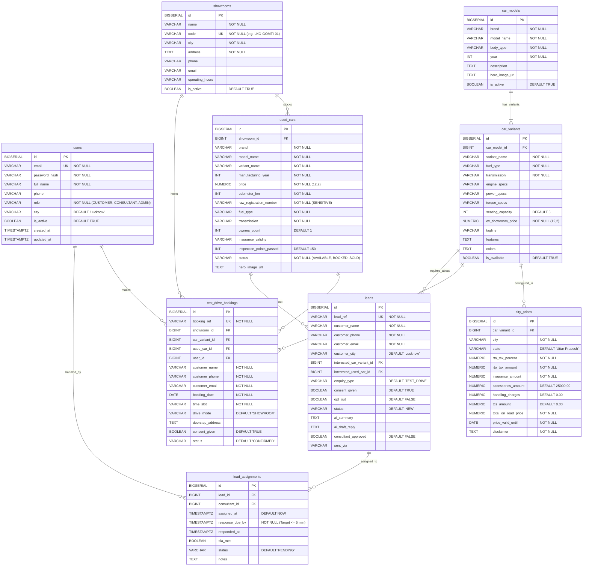

# AutoVista — Database Schema & Entity Relationship (ER) Model

## 1. Entity-Relationship (ER) Diagram



---

## 2. Table Catalog & Constraint Specifications

### 1. `users`
- Stores credentials, identities, contact numbers, and system roles.
- **Constraints**: `uq_users_email` UNIQUE (`email`).
- **Indexes**: `idx_users_email`, `idx_users_role`.

### 2. `showrooms`
- Physical dealership facilities in Lucknow and regional branches.
- **Constraints**: `uq_showrooms_code` UNIQUE (`code`).
- **Indexes**: `idx_showrooms_city`.

### 3. `car_models`
- Vehicle brand and model lines (e.g. Model H, Model X, Model E).
- **Constraints**: `uq_car_models_brand_model_year` UNIQUE (`brand`, `model_name`, `year`).
- **Indexes**: `idx_car_models_brand`.

### 4. `car_variants`
- Specific trim levels, powertrains, and ex-showroom price points.
- **Constraints**: `fk_car_variants_model` FOREIGN KEY (`car_model_id`) REFERENCES `car_models(id)` ON DELETE CASCADE; `uq_variant_model_name` UNIQUE (`car_model_id`, `variant_name`).
- **Indexes**: `idx_car_variants_model`, `idx_car_variants_fuel`.

### 5. `used_cars`
- Pre-owned vehicle inventory with verified mileage and inspection metrics.
- **Sensitive Field Privacy Rule**: `raw_registration_number` is stored in the database for dealership titling, but is **strictly masked** (`maskRegistrationNumber()`) before leaving the backend API.
- **Indexes**: `idx_used_cars_status`, `idx_used_cars_showroom`.

### 6. `city_prices`
- Administrative pricing matrices configuring RTO taxes, comprehensive insurance, standard accessories, and TCS.
- **Constraints**: `uq_city_prices_variant_city` UNIQUE (`car_variant_id`, `city`).
- **Indexes**: `idx_city_prices_city`.

### 7. `test_drive_bookings`
- Appointment booking logs for showroom visits or doorstep vehicle trials.
- **Mandatory Business Rule #6 Database Constraint**:
  ```sql
  CONSTRAINT uq_test_drive_duplicate_slot UNIQUE (showroom_id, booking_date, time_slot);
  ```
  Guarantees at the relational database level that double-bookings for the same showroom, date, and time slot are impossible, preventing race conditions.

### 8. `leads`
- Customer enquiries originating from test drives, on-road quotes, and general requests.
- **Consent Tracking**: Tracks explicit customer consent (`consent_given = TRUE`) and immediate opt-out capability (`opt_out = TRUE`).
- **AI Integration Foundation**: Contains `ai_summary` and `ai_draft_reply` columns with a mandatory consultant review flag (`consultant_approved = FALSE` by default).

### 9. `lead_assignments`
- Automated routing of customer leads to sales specialists.
- **Mandatory 5-Minute SLA**: Enforces `response_due_by = assigned_at + INTERVAL '5 minutes'` to track and guarantee dealership response standards.
